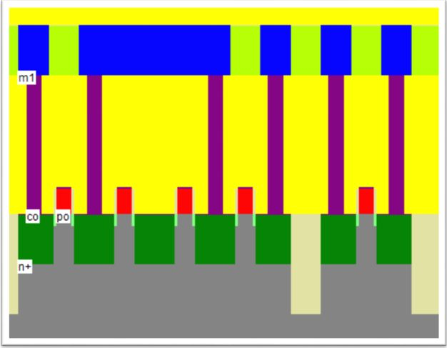
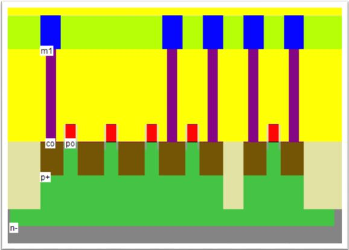
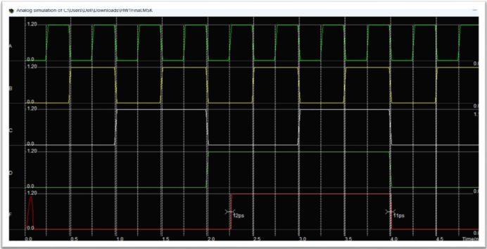
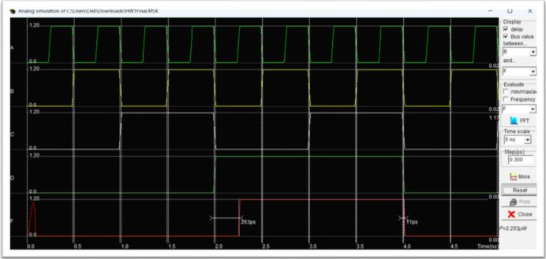
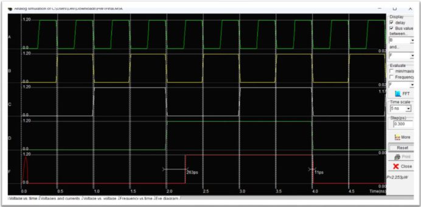
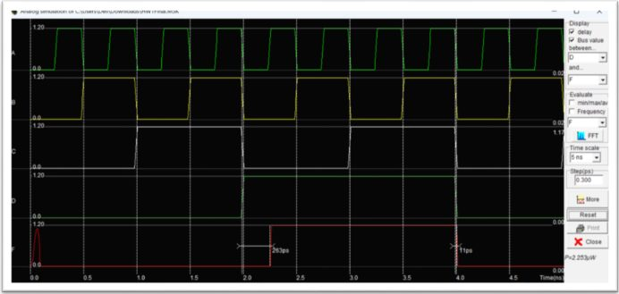
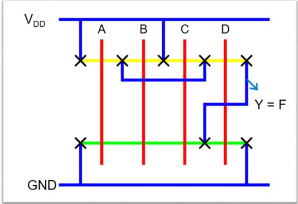
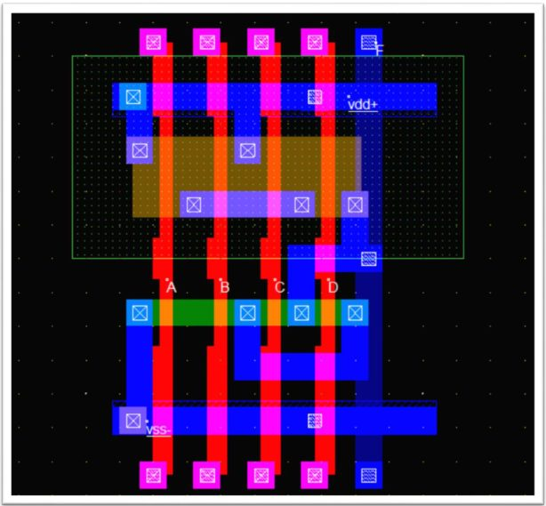

# VLSI CMOS Design 

## Overview

This repository contains the implementation of Homework 1 for the VLSI course at An-Najah National University. It covers CMOS complex logic gate design, transistor sizing, schematic implementation, physical layout, and propagation-delay analysis.

## Tools Used

- **DSCH 3.5** – CMOS schematic design.
- **Microwind 2.7** – CMOS layout design, cross-section visualization, and built-in SPICE simulation.

## Part 1 – CMOS Complex Gate Design

**Boolean Function:**

\[
F=(A+B+C)D
\]

### Design Tasks

- Draw the CMOS transistor-level schematic and size the transistors relative to the Unit Inverter.
- Implement the physical layout in Microwind, including body contacts.
- Generate the NMOS and PMOS cross-sections.
- Simulate the circuit using the built-in SPICE simulator.
- Measure the propagation delays from inputs **A**, **B**, **C**, and **D** to output **F**.
- Verify the truth table and check the layout against DRC rules.

### Cross-Section Results

**NMOS Cross Section**

**PMOS Cross Section**

### Propagation Delay – SPICE Simulation

The following screenshots show the simulated input and output waveforms and the measured delay for each input.

**Input A to Output F**

**Input B to Output F**

**Input C to Output F**

**Input D to Output F**

## Part 2 – CMOS Complex Gate Design

**Boolean Function:**

\[
F=~{ABC+D}
\]

### Design Tasks

- Draw the CMOS transistor-level schematic and size the transistors relative to the Unit Inverter.
- Draw the stick diagram manually.
- Generate the physical layout using Microwind's **Compile One Line** feature.

### Stick Diagram

### Compiled Layout

## Project Files

| File | Description |
|---|---|
| `Part1-A.sch` | Part 1 schematic file (DSCH) |
| `Part2-A.sch` | Part 2 schematic file (DSCH) |
| `Func.MSK` | Microwind layout file |
| `images/` | Screenshots of cross-sections, delay simulations, stick diagram, and compiled layout |

## Course Information

- **University:** An-Najah National University
- **Department:** Computer Engineering
- **Course:** VLSI (10636568)

---

*Academic project – VLSI Homework 1*
